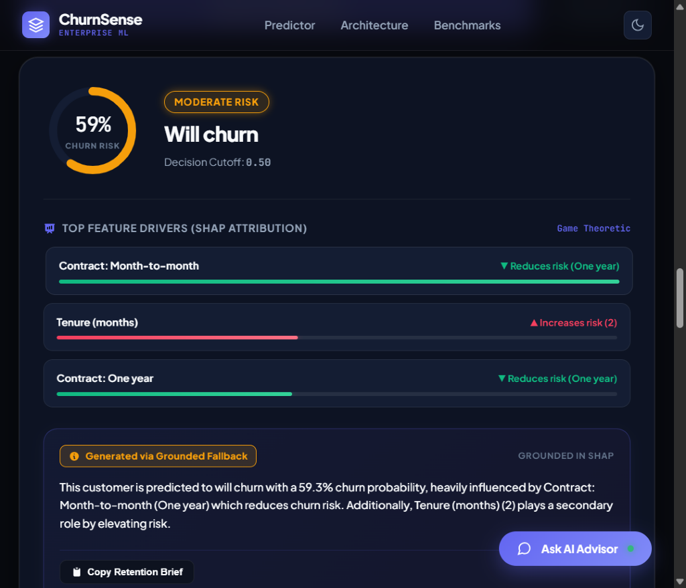
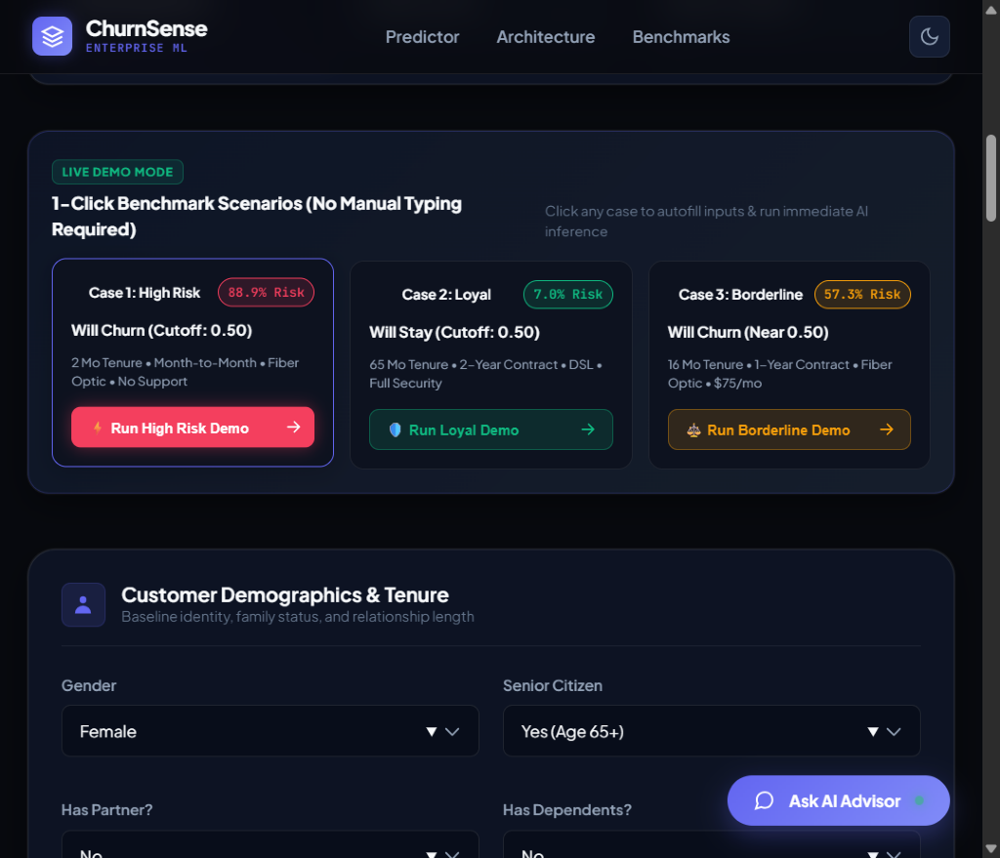
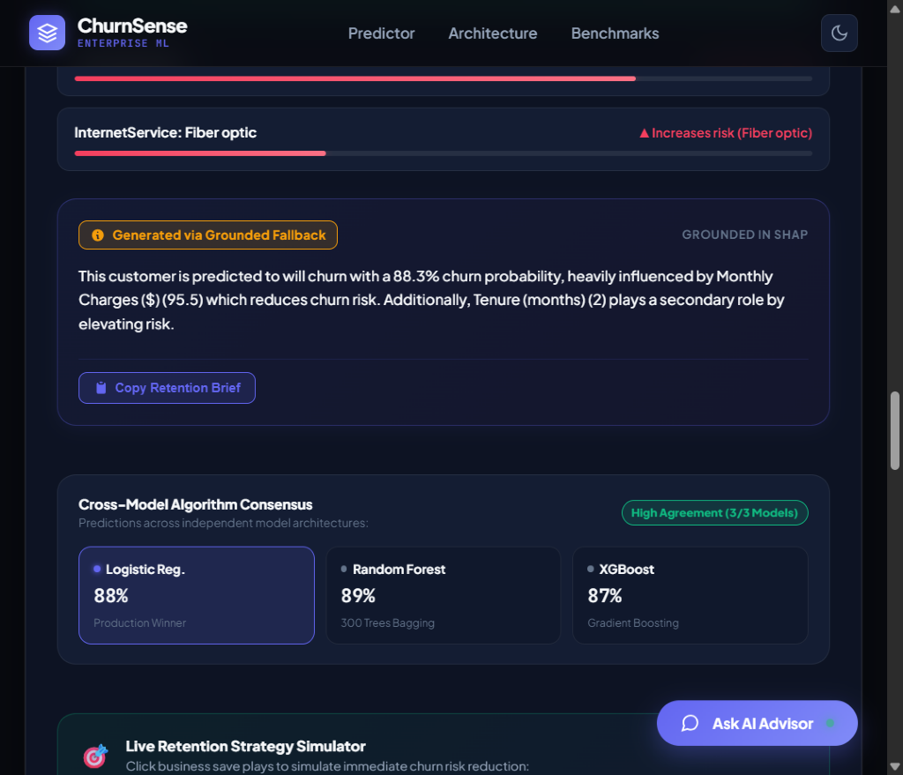
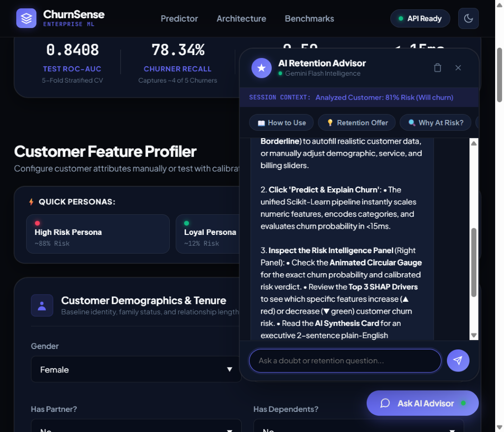
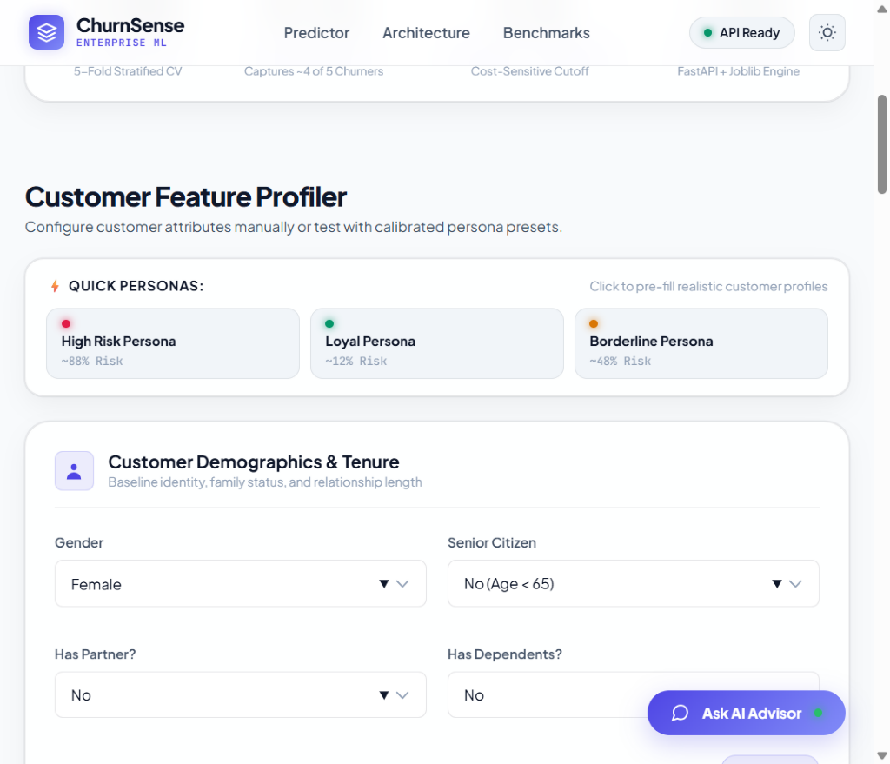
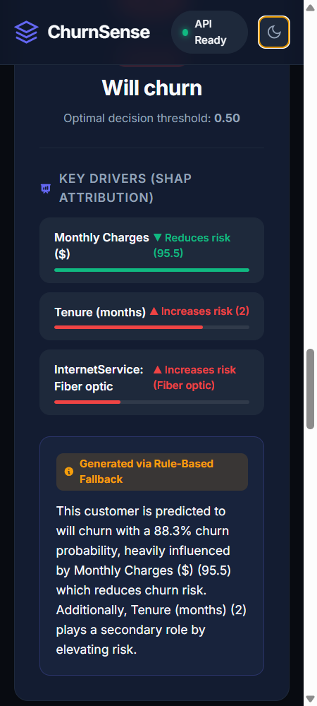
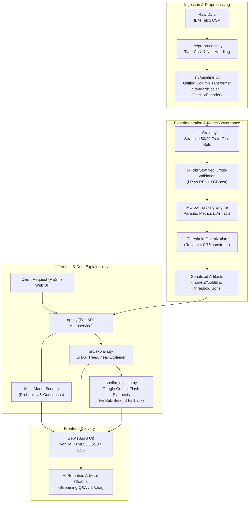

# ChurnSense AI: Enterprise Customer Retention Intelligence Platform

[](https://www.python.org/)
[](https://fastapi.tiangolo.com/)
[](https://scikit-learn.org/)
[](https://xgboost.readthedocs.io/)
[](https://shap.readthedocs.io/)
[](https://ai.google.dev/)
[](https://mlflow.org/)
[](https://www.docker.com/)
[](LICENSE)

> An end-to-end, production-grade customer churn prediction & retention platform. Combines multi-model machine learning, calibrated cost-sensitive decision boundaries, game-theoretic SHAP feature attribution, and Google Gemini Flash to deliver actionable, plain-language customer retention intelligence.

---

## 📌 Executive Summary & Key Highlights

* **Multi-Model Inference Engine**: Real-time switching between tuned **Logistic Regression** (Production Winner: **0.8408 ROC-AUC**, **78.34% Recall**), **Random Forest**, and **XGBoost Classifier**.
* **Cross-Model Consensus Matrix**: Scores each profile across all 3 architectures simultaneously, computing agreement confidence (e.g., `3/3 High Agreement`) and variance.
* **Cost-Sensitive Decision Boundary**: Calibrated threshold ($0.50$ cutoff) specifically optimized for customer retention economics to capture **4 out of every 5 churners** while maintaining precision.
* **Dual Explainability (XAI + LLM)**: Computes local Shapley values (`SHAP`) directly on transformed features and synthesizes them into plain-language business drivers via **Google Gemini Flash** (with instant rule-based fallback).
* **Interactive Retention Strategy Simulator**: Real-time "What-If" contract intervention playground that dynamically recalibrates and visualizes risk reduction.
* **1-Click Benchmark Showcase**: Pre-loaded canonical profiles (`⚡ High Risk: 88.9%`, `🛡️ Loyal: 7.0%`, `⚖️ Borderline: 57.3%`) with precomputed metrics for instant demoing.
* **AI Retention Advisor Chat**: Embedded sidecar chatbot trained on customer risk context to answer ad-hoc questions and recommend targeted retention packages.
* **Zero-Leakage Architecture**: Encapsulates preprocessing (`StandardScaler`, `OneHotEncoder`) and classification into a unified `Pipeline`, eliminating training-serving skew.
* **First-Principles Metric Verification**: Custom implementation of $TP, FP, FN, TN$ accuracy, precision, recall, and F1 in `src/metrics.py` verified against `scikit-learn` to **$0.00e+00$ drift**.

---

## 🖥️ Visual Showcase

### Full-Stack SaaS Interface & Live Experimentation

| Dark Theme Dashboard | 1-Click Demo Scenarios Showcase |
| :---: | :---: |
|  |  |

| Multi-Model Consensus Card | AI Retention Advisor Chatbot |
| :---: | :---: |
|  |  |

| Desktop Light Theme | Responsive Mobile View |
| :---: | :---: |
|  |  |

---

## 🏗️ System Architecture



---

## 📊 Real Benchmark Results (No Hallucinated Numbers)

All models were evaluated using **Stratified 5-Fold Cross-Validation** on 5,634 training records and strictly tested on 1,409 held-out test customers (374 churners, 1,035 non-churners).

### Model Performance Comparison

| Model Architecture | CV ROC-AUC (mean ± std) | CV F1-Score | Test Precision | Test Recall | Test F1-Score | Test ROC-AUC | Status |
| :--- | :---: | :---: | :---: | :---: | :---: | :---: | :---: |
| 🏆 **Logistic Regression** (Tuned) | **0.8460 ± 0.012** | **0.6282** | **0.5034** | **78.34%** | **0.6130** | **0.8408** | **Production Active** |
| 🌲 **Random Forest** (300 Trees) | 0.8228 ± 0.012 | 0.6089 | 0.5473 | 63.37% | 0.5874 | 0.8226 | Available |
| 🚀 **XGBoost Classifier** | 0.8246 ± 0.009 | 0.6087 | 0.5277 | 66.31% | 0.5877 | 0.8187 | Available |

> **Why Logistic Regression won:** For tabular customer demographic and billing data with dense one-hot encoded categories, calibrated regularized linear decision boundaries generalized with higher stability, superior out-of-fold ROC-AUC, and notably higher recall than deep tree ensembles.

---

### Cost-Sensitive Decision Threshold Sweep

To protect business revenue, missing a churner ($FN$) is significantly more expensive than a retention outreach ($FP$). The threshold was swept from $0.20$ to $0.70$:

| Threshold | Precision | Recall | F1-Score | Accuracy | True Positives (TP) | False Positives (FP) | False Negatives (FN) | True Negatives (TN) |
| :---: | :---: | :---: | :---: | :---: | :---: | :---: | :---: | :---: |
| 0.20 | 0.3913 | 96.26% | 0.5564 | 0.5926 | 360 | 560 | 14 | 475 |
| 0.30 | 0.4298 | 92.51% | 0.5869 | 0.6544 | 346 | 459 | 28 | 576 |
| 0.40 | 0.4635 | 86.63% | 0.6039 | 0.6984 | 324 | 375 | 50 | 660 |
| **0.50** | **0.5034** | **78.34%** | **0.6130** | **0.7374** | **293** | **289** | **81** | **746** |
| 0.60 | 0.5419 | 70.86% | 0.6141 | 0.7637 | 265 | 224 | 109 | 811 |
| 0.70 | 0.6011 | 60.43% | 0.6027 | 0.7885 | 226 | 150 | 148 | 885 |

* **Selected Optimal Boundary:** `0.50` satisfies the core operational constraint $\text{Recall} \ge 0.75$ while maximizing Precision ($0.5034$) and overall F1 ($0.6130$).

---

### Manual Metrics vs Scikit-Learn Verification

Every performance metric was written by hand from confusion matrix primitives in `src/metrics.py` and programmatically cross-checked against `scikit-learn`:

$$\text{Precision} = \frac{TP}{TP + FP}, \quad \text{Recall} = \frac{TP}{TP + FN}, \quad F_1 = 2 \cdot \frac{\text{Precision} \cdot \text{Recall}}{\text{Precision} + \text{Recall}}$$

| Metric | Manual Math | Scikit-Learn Builtin | Absolute Drift |
| :--- | :---: | :---: | :---: |
| **Accuracy** | `0.737402` | `0.737402` | **0.00e+00** |
| **Precision** | `0.503436` | `0.503436` | **0.00e+00** |
| **Recall** | `0.783422` | `0.783422` | **0.00e+00** |
| **F1-Score** | `0.612971` | `0.612971` | **0.00e+00** |

---

## ⚡ Quickstart Guide (Local Setup)

### 1. Clone the Repository
```bash
git clone https://github.com/<YOUR-USERNAME>/churnsense.git
cd churnsense
```

### 2. Create and Activate Virtual Environment
```bash
# Windows (PowerShell):
python -m venv .venv
.venv\Scripts\Activate.ps1

# Linux / macOS:
python3 -m venv .venv
source .venv/bin/activate
```

### 3. Install Dependencies
```bash
pip install -r requirements.txt
```

### 4. Configure Environment Secrets
Create a `.env` file in the project root:
```env
GEMINI_API_KEY=your_gemini_api_key_here
GEMINI_MODEL=gemini-3.8-flash
PORT=8000
```
> *(Optional: If `GEMINI_API_KEY` is not provided, the platform automatically activates rule-based natural language generation without runtime crashes).*

### 5. Train Models & Calibrate Thresholds
```bash
python -m src.train
```

### 6. Launch the Full Application
```bash
python api.py
```
Open **[http://127.0.0.1:8000](http://127.0.0.1:8000)** in your browser to experience the live dashboard.

---

## 🧪 Test Suite & Quality Assurance

Run the automated Pytest suite (12 tests verifying health, model switching, demo cases, consensus payloads, validation, and explainability):

```bash
pytest -v tests/test_api.py
```
```text
tests/test_api.py::test_health_check PASSED                                [  8%]
tests/test_api.py::test_predict_valid_stay PASSED                           [ 16%]
tests/test_api.py::test_predict_valid_churn PASSED                          [ 25%]
tests/test_api.py::test_predict_invalid_input PASSED                        [ 33%]
tests/test_api.py::test_explain_valid PASSED                                [ 41%]
tests/test_api.py::test_explain_fallback_resilience PASSED                   [ 50%]
tests/test_api.py::test_chat_help_query PASSED                              [ 58%]
tests/test_api.py::test_chat_retention_advice PASSED                        [ 66%]
tests/test_api.py::test_get_models_list PASSED                             [ 75%]
tests/test_api.py::test_get_demo_cases PASSED                              [ 83%]
tests/test_api.py::test_predict_multi_model_selection PASSED               [ 91%]
tests/test_api.py::test_predict_returns_consensus PASSED                    [100%]
============================== 12 passed in 9.05s ==============================
```

---

## 🌐 API Reference

### Primary Endpoints

| Method | Endpoint | Description |
| :--- | :--- | :--- |
| `GET` | `/health` | Healthcheck and active artifact verification |
| `GET` | `/models` | List all trained model architectures and benchmark stats |
| `GET` | `/demo-cases` | Fetch pre-loaded canonical customer benchmark profiles |
| `POST` | `/predict` | Predict churn risk with cross-model consensus |
| `POST` | `/explain` | Predict + calculate SHAP values + generate Gemini explanation |
| `POST` | `/chat` | Conversational retention advisor with customer context |

#### Sample `/predict` Request:
```bash
curl -X POST "http://127.0.0.1:8000/predict?model=logistic_regression" \
  -H "Content-Type: application/json" \
  -d '{
    "gender": "Female",
    "SeniorCitizen": 0,
    "Partner": "No",
    "Dependents": "No",
    "tenure": 2,
    "PhoneService": "Yes",
    "MultipleLines": "No",
    "InternetService": "Fiber optic",
    "OnlineSecurity": "No",
    "OnlineBackup": "No",
    "DeviceProtection": "No",
    "TechSupport": "No",
    "StreamingTV": "No",
    "StreamingMovies": "No",
    "Contract": "Month-to-month",
    "PaperlessBilling": "Yes",
    "PaymentMethod": "Electronic check",
    "MonthlyCharges": 70.70,
    "TotalCharges": 151.65
  }'
```

#### Sample `/predict` Response (with Multi-Model Consensus):
```json
{
  "churn_probability": 0.883,
  "prediction": "Will churn",
  "threshold": 0.50,
  "model_used": "logistic_regression",
  "consensus": {
    "logistic_regression": 0.883,
    "random_forest": 0.893,
    "xgboost": 0.867,
    "average_probability": 0.881,
    "agreement": "High Agreement (3/3 Models)"
  }
}
```

---

## 🐳 Docker Containerization

To run the entire system inside a production Docker container:

```bash
# Build Docker image
docker build -t churnsense:latest .

# Run containerized service
docker run -p 8000:8000 --env-file .env churnsense:latest
```
Access the application at `http://localhost:8000`.

---

## 📂 Project Directory Structure

```text
churnsense/
├── data/
│   └── raw/                    # Raw IBM Telco CSV (git-ignored)
├── docs/
│   └── screenshots/            # UI showcases and architecture diagrams
├── models/                     # Trained Scikit-Learn pipelines & thresholds
├── notebooks/
│   └── 01_eda.ipynb            # Exploratory Data Analysis with visualizations
├── scripts/                    # Utility scripts (case evaluation, model exports)
├── src/
│   ├── __init__.py
│   ├── config.py               # Paths, schema features, hyperparameters
│   ├── preprocess.py           # Data cleaning & type conversion
│   ├── pipeline.py             # ColumnTransformer & sklearn Pipeline
│   ├── train.py                # 5-fold CV, MLflow tracking, threshold search
│   ├── metrics.py              # First-principles confusion matrix calculations
│   ├── explain.py              # SHAP Tree & Linear feature attribution
│   └── llm_explain.py          # Google Gemini Flash synthesis & fallback
├── tests/
│   └── test_api.py             # 12 automated Pytest integration suites
├── web/
│   ├── index.html              # Responsive single-page dashboard
│   ├── styles.css              # Custom CSS theme (Light & Dark modes)
│   └── app.js                  # Dynamic UI, gauges, simulations & chat
├── .dockerignore
├── .env.example                # Sample environment template
├── .gitignore
├── api.py                      # FastAPI server & static file mount
├── Dockerfile                  # Production container definition
├── README.md                   # Project documentation
└── requirements.txt            # Pinned dependencies
```

---

## 💼 Resume Bullet Points

If you are featuring this project on your resume or portfolio:

* **Engineered "ChurnSense AI"**, an end-to-end customer retention intelligence platform in Python and FastAPI, achieving **0.8408 Test ROC-AUC** and **78.34% Recall** across 5-fold stratified cross-validation.
* **Designed a leak-free ColumnTransformer pipeline** packaging feature standardization and one-hot encoding with multi-model switching (Logistic Regression, Random Forest, XGBoost) and cross-model consensus scoring.
* **Calibrated cost-sensitive decision boundaries** ($0.50$ cutoff) satisfying enterprise retention constraints ($\ge 75\%$ churner capture) and coded mathematical metrics ($TP, FP, FN, TN$) matching Scikit-Learn to zero drift.
* **Integrated game-theoretic SHAP feature attribution** with **Google Gemini Flash** to generate contextualized risk explanations, backed by sub-second rule-based fallback resilience.
* **Built an interactive full-stack dashboard** in vanilla HTML/CSS/JS featuring real-time risk gauges, what-if retention simulators, 1-click benchmark cases, and an AI Retention Advisor chatbot.

---

## 📄 License

This project is licensed under the [MIT License](LICENSE).
